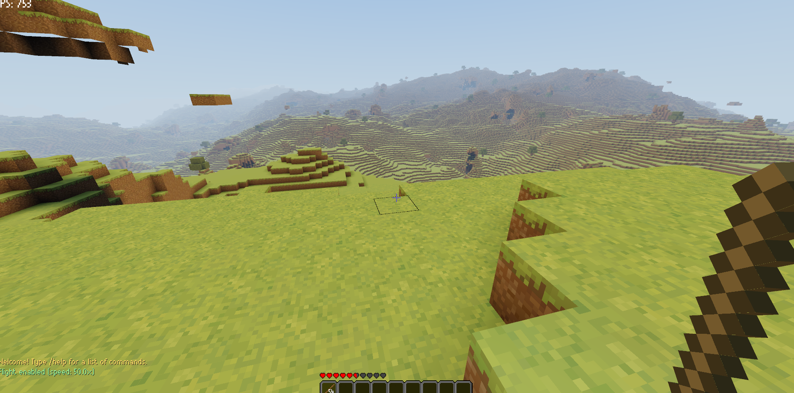

# Farlands — Game Overview

**A first-person voxel sandbox about arriving in a generated world, taking it apart, and
building something else out of it — with goblins in the way.**

This is the player-facing answer to "what is Farlands?" It is not the build guide
([README.md](README.md)), the engine tour ([ARCHITECTURE.md](ARCHITECTURE.md)) or the
engineering record ([AGENTS.md](AGENTS.md)). If you need to explain the game to someone, the
three versions below are the short answer; the rest is the tour.

## The pitch, at three lengths

**One sentence.** Farlands is a Minecraft-style voxel sandbox where you explore a procedurally
generated world, mine and build with a hotbar, inventory and crafting, play with flowing water,
lava and acid, and fight goblins that pathfind, chase and flee.

**Thirty seconds.** Farlands drops you into an endless block world of plains, hills and oceans.
You can break almost any block, carry it, craft tools, and build whatever you want while the
terrain streams in around you. The world has a day/night cycle, animated liquids, coloured
lighting and a long draw distance. It is not a story game: the loop is explore, gather, build
and experiment — and the goblins are real entities with routes, combat and loot, not scenery.

**One minute.** Farlands is a single-player voxel sandbox built on Godot 4 with a custom C++
engine core. The world is generated from climate and noise: plains, hills and oceans, with
overhangs and shelves where the terrain gets strange. You can mine and place a large block
palette, craft tools, carry a 9-slot hotbar and 27-slot inventory, and build with slabs, stairs,
walls and fences. Water, lava and acid flow with their own rules and can be bucketed and
poured. There is health, fall damage, drowning and a respawn screen, plus a punchable training
dummy. The headline creature is the goblin: it wanders on planned routes, fights back when hit,
calls nearby goblins, chases, flees when badly hurt, picks up whatever you leave lying about,
and drops loot. Around the game are creation tools: a skin painter, a block painter, a liquid
texture lab, texture packs and screen-effect shaders. It is in active development:
single-player only, no sound yet, and one save.

## What it is

- **Genre:** first-person voxel sandbox — mine, build, explore, fight.
- **World:** procedural, effectively endless horizontally, 1024 blocks tall, streamed in
  chunks around the player.
- **Mode:** single-player, creative-leaning. You can fly and build freely, but health, fall
  damage, drowning and goblins give it a survival edge. There is no hunger or story campaign.
- **Status:** in active development. The engine is custom C++; the game layer is Godot 4.

## A tour of the game

### Explore a generated world

- Plains, hills and oceans come from a climate grid; oceans are chosen after the land, so
  coasts meet cleanly instead of being stitched together.
- The terrain has broad relief, domain-warped ridges, and overhangs and shelves in the
  "weirdness" zones where the 3D shape field is strong.
- Trees, sand, grass, stone and layered surfaces follow the biome.
- A day/night cycle moves the sky, stars, fog and god rays. The night is dark enough for block
  light and held light to matter.
- Oceans and poured liquids are swimmable; you sink slowly, rise with jump, and take no fall
  damage on entry.
- `/locatebiome` finds the nearest ocean, hills or plains, and the answer is a clickable
  teleport link.

### Mine, build and craft

- Break and place blocks with hardness, tool tiers, a ten-stage break animation and a
  first-person swing.
- Pickaxes, axes and hammers in wood, stone, copper and iron; hammers crush some blocks into
  others, and blocks have their own drops.
- Non-cube shapes: slabs, stairs, walls, poles and fences, with collision that matches what
  you see.
- A 9-slot hotbar and 27-slot inventory with drag/drop, shift-click transfer, stack splitting
  and a held-item name popup.
- 2x2 crafting in the inventory and a 3x3 crafting table, with shaped and shapeless recipes.
- Dropped items are real world objects: throw one with Q, watch it fall, and pick it back up.
- `/give`, `/tp`, `/time`, `/paste` and the other chat commands make it easy to test or build
  without grinding.

### Survive the world

- Ten hearts of health, fall damage, drowning with an air meter, suffocation and cactus
  contact damage.
- A hurt window, knockback, a directional screen lean and a death/respawn screen. Your
  inventory is kept when you die.
- A punchable combat dummy for testing knockback and damage without a goblin.
- No hunger bar: the survival pressure is the terrain, the water and whatever is chasing you.

### Play with liquids

- Water, lava and acid each flow with their own reach, speed and pooling rules.
- Buckets pour a source and pick one back up, so a spill is reversible.
- Generated ocean water is deliberately inert; only poured water ticks and spreads.
- Liquid textures are generated and animated rather than shipped as a fixed strip, and the
  Liquid Texture Lab lets you author your own.

### Make it yours

- Settings for render quality, fog, god rays, lighting, crosshair, block outline and
  per-action controls, with shareable codes for the crosshair and outline.
- A Skin Maker with paint tools, a 3D preview and a saved gallery.
- A Block Maker that paints a 16x16 block texture and previews it on a cube.
- Texture packs loaded from `user://packs/`, with per-block overrides.
- A shader-effect stack: Hand Drawn, CRT Screen, Phosphor Trail, Invert/Sepia, Camera Jitter,
  World Bend and the Horizon Curve.
- `/paste` reads Minecraft build files (`.schematic`, `.schem`, `.nbt`) and places them into
  the world.

## The goblin, explained

The goblin is the first real mob in Farlands, and the best single answer to "what is there to
do?" It is not an animated prop: it is a body with the same movement simulation as the player,
a route planner, a combat state, a pair of hands and a loot table.

- **Spawn it:** press `G` while looking at a block, use **Tools → Spawn Goblin** in the pause
  menu, or get a `goblin_egg` with `/give` and right-click. Each press adds another goblin.
- **Body:** six hearts (12 half-hearts). Your punch takes half a heart, so twelve hits kill it.
  Nothing floats over its head; you read the fight from its hurt reaction and knockback.
- **Movement:** the same fixed 20-tick simulation as the player — gravity, ground and air
  acceleration, 0.6-block step-up, jumping, swimming and knockback. It is not on rails.
- **Idle:** it stands still most of the time, then rolls a stroll, picks a nearby column and
  walks there along a planned route. It steps up, jumps gaps and drops off ledges.
- **Angry:** punch it and it turns on you. Other goblins within 32 blocks on every axis join
  in, and the anger lasts 20 to 40 seconds. Every new hit resets that clock.
- **Chase:** it re-plans every few ticks, closes to about a body's width, and hits for a heart
  about once a second at roughly 1.45 blocks of reach. If it cannot find a route for three
  seconds, it gives up and goes back to wandering.
- **Flee:** at two hearts it stops fighting and runs, aiming for ground about eight blocks
  away, until you are sixteen blocks off.
- **Loot:** with an empty main hand and nothing better to do it scans for a dropped pile twice
  a second — eight blocks away at most, two blocks above or below — walks over and takes ONE
  item. It turns that item over in front of its face for three seconds, then keeps it if it is
  a tool (pickaxe, axe, hammer or sword) and throws it back down if it is not. A torch goes
  into a free offhand instead. What it carries changes nothing about it: no extra damage, no
  mining, no inventory. Piles in water are left for you.
- **Offhand:** a quarter of goblins carry a torch in the left hand — rolled once at spawn.
  There is no offhand slot to use it from; it just hangs there, lights the ground, the water
  and the things around the goblin, and is always dropped on death. It can be filled later,
  though: a torchless goblin that picks up a dropped torch puts it in that hand rather than
  its main one.
- **Death:** it drops loot from `data/loot_tables.json`: pebbles, silver coins, and sometimes
  a goblin ear — plus whatever it was holding, a torch or a tool it picked up.
- **Data-driven:** `data/mobs.json` holds its health, damage, speed, follow range, alert box
  and anger window. Tuning a goblin is a JSON diff, not a code change.

### Try this in game

1. Press `G` while looking at the ground. A goblin drops onto the block.
2. Punch it once. It turns, and any goblin within 32 blocks turns too.
3. Back away and watch it route around blocks, step up, jump gaps and swim.
4. Let it close. It stops about a body away and hits for a heart.
5. Hit it down to two hearts. It runs; let it get sixteen blocks away and it calms down.
6. Throw a sword or a torch down with `Q` near an idle goblin and step back: it walks over,
   picks it up and turns it over for a few seconds.
7. Kill it and pick up the pebbles, coins or ear it leaves — and whatever it was carrying.

Under the hood the goblin is the proof that entities work: it uses the same fixed-tick body as
the player, the engine's Godot-free A* planner, data-driven stats and loot, and the same
knockback and hurt window. Its loot run reads the world's own dropped-item piles rather than a
mob-side copy, so what it picks up is what you left there. The numbers and loot are already
data, so the next mob starts from an entry and a model rather than a copied sheet of
constants.

## What is not there yet

Farlands is a development build, not a finished game. The honest list:

- **Single-player only.** The MULTIPLAYER row says it is not in this build.
- **No audio.** Nothing plays a sound yet.
- **One save.** There is a world list and a Continue flow, but no New World button yet.
- **Goblins are summoned, not a population.** They spawn from the G key, the Tools page or an
  egg, and they are not saved with the world yet.
- **One mob and a dummy.** The goblin is the only creature; the combat dummy is a training
  prop.
- **No hunger, story, quests or win condition.** The sandbox is the game.

## For the technical friend

Godot 4 handles the window, input and UI; a C++ GDExtension does the voxel work. Chunks are
32x32x32 and palette-compressed, streamed with frustum priority, meshed greedily and reduced
by distance LOD. Lighting has a sky channel and a coloured block channel. Saves are
snapshotted under their shard lock and written asynchronously with an atomic replace. Terrain,
biomes, recipes, loot and mob stats are data-driven JSON. The goblin's routes come from a
Godot-free A* planner, and its body uses the same fixed 20-tick simulation as the player. A
crowd shares work rather than repeating it: goblins chasing one target read a single flow field
instead of planning per body, plans are admitted under a per-tick budget, and crowd separation
is one batched native call. A goblin body is drawn as one instanced rig, so a hundred of them
cost the same six draw calls as one.
Tests, benchmarks and in-game probes cover the systems; the engineering record is
[AGENTS.md](AGENTS.md).

## Where to go next

- **Play, build or rebind controls:** [README.md](README.md).
- **How the engine works and why:** [ARCHITECTURE.md](ARCHITECTURE.md).
- **Every system and schema:** [docs/README.md](docs/README.md).
- **Goblin details:** [docs/ui.md](docs/ui.md), [docs/pathfinding.md](docs/pathfinding.md) and
  [docs/mob-plan.md](docs/mob-plan.md).
- **Goblin numbers:** [data/mobs.json](data/mobs.json) and
  [data/loot_tables.json](data/loot_tables.json).
